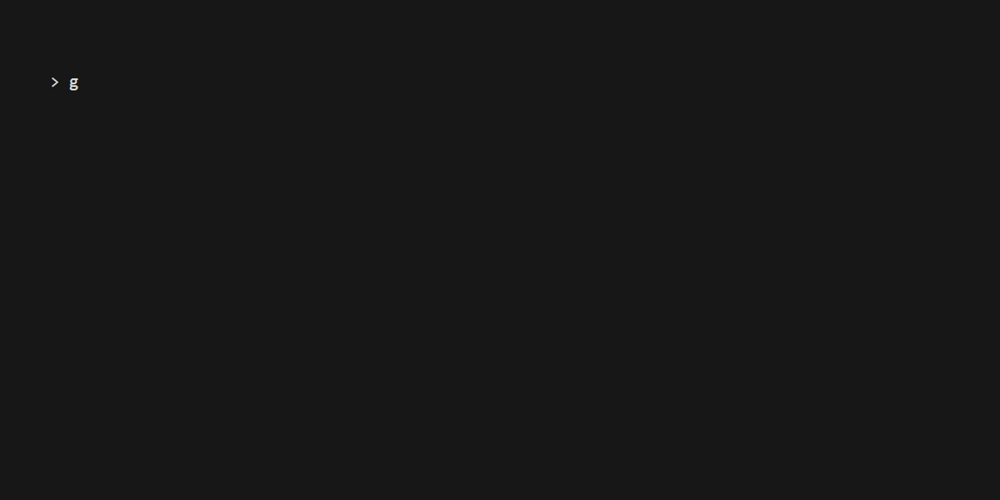
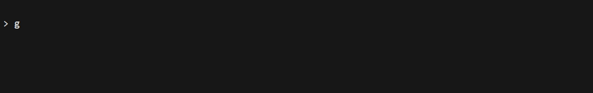
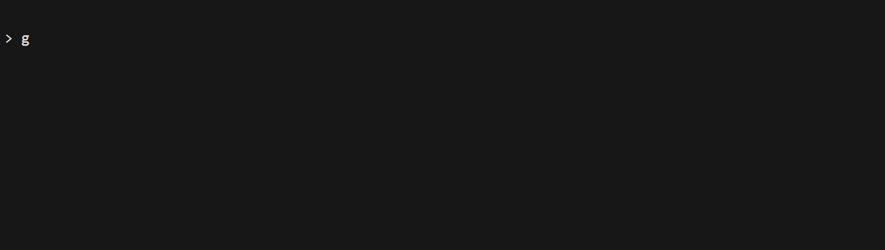
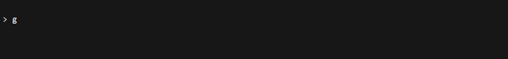

# mpb

`github.com/quant1x/mpb` 是 Rust 进度条库 [indicatif](https://github.com/console-rs/indicatif) 的 Go 移植，
按模块逐一对照实现（`style` / `state` / `draw_target` / `multi` / `progress_bar` / `iter` / `format` / `in_memory` / `term_like`），
目标是与 Rust 侧**逐语义对齐**：同样的模板语法、同样的宽度与换行度量、同样的僵尸行（zombie）算法。

## 来源

| 项 | 值 |
|---|---|
| 上游仓库 | <https://github.com/console-rs/indicatif> |
| **上游版本** | **0.18.6** |
| **上游 commit** | **3adb05c80429415743d8142503c24fa8ee639453**（短号 `3adb05c`，2026-10-06） |
| 上游本地副本 | `<UPSTREAM_DIR>` |

本文档用尖括号表示需要自行替换的变量：

- `<UPSTREAM_DIR>` —— 本地克隆 indicatif 的目录，例如 `d:/projects/rust/indicatif`
- `<OLD_COMMIT>` —— 要对比的上游提交

本仓库**不再随附** Rust 源码：上游的 `.rs`、`examples/`、`tests/`、`Cargo.toml` 等已全部移除，
改 Go 时直接看 `<UPSTREAM_DIR>`。要对比两个版本的差异：

```powershell
git -C <UPSTREAM_DIR> --no-pager diff <OLD_COMMIT> HEAD -- src/
```

已知同步点：`<OLD_COMMIT>` 取 `3adb05c` 之前的那次提交，即可看到 0.18.6 这一批改动。

## 模块对照

| Rust（上游） | Go（本仓库） | 内容 |
|---|---|---|
| `style.rs` | `style.go` | 模板解析（`{bar:40.red/blue}`）、样式（`on_*` 背景、256 色、真彩色）、宽度度量 |
| `state.rs` | `state.go` | `BarState` / `ProgressState`、绘制状态与出帧 |
| `draw_target.rs` | `draw_target.go` | 绘制目标（终端 / term-like / multi / hidden）、限速、行数调整 |
| `multi.rs` | `multi.go` | `MultiProgress` / `MultiState`、成员排序、orphan 行、僵尸行 |
| `progress_bar.rs` | `progress_bar.go` | `ProgressBar` 门面 |
| `iter.rs` / `rayon.rs` | `iter.go` / `rayon.go` | 迭代器包装 |
| `format.rs` | `format.go` | `HumanBytes` / `HumanDuration` / `HumanFloatCount` 等格式化 |
| `in_memory.rs` / `term_like.rs` | `in_memory.go` / `term_like.go` | 内存终端（测试用）与终端抽象 |
| `lib.rs` | `doc.go` | 包文档（`go doc` 可见） |

（左侧是上游文件名，本仓库只有右列的 Go 文件；上游源码见上面的本地副本路径。）

## 示例与效果

16 个示例与上游 `examples/` 一一对应，动画用 [VHS](https://github.com/charmbracelet/vhs) 录制，
tape 文件与 GIF 同名，都在 `screenshots/`：

批量重录用 `scripts/` 下的两个脚本（PowerShell 与 bash 各一份，行为一致；脚本自己会切到
仓库根目录，所以从任何地方调用都行 —— tape 里的 `Output` 路径相对 cwd 解析）：

```powershell
./scripts/generate.ps1              # 全部 16 条
./scripts/generate.ps1 single log   # 只重录指定的几条（基名，不带扩展名）

$env:VHS = 'c:\runtime\work\bin\vhs.exe'   # vhs 不在 PATH 里时这么指定
./scripts/generate.ps1
```

```bash
./scripts/generate.sh              # 全部 16 条
./scripts/generate.sh single log   # 只重录指定的几条

VHS=/path/to/vhs ./scripts/generate.sh
```

两条脚本都会跳过 `_` 开头的探针 tape，逐条打印产物大小与耗时，失败时列出失败的 tape 并以
退出码 1 结束。

### `cargo`

模拟 cargo 编译时的输出（**并不真的调用 cargo**）：4 个 worker 并发从 crate 列表取任务，
主线程负责画进度条并打 `Compiling` 行。

```powershell
go run ./examples/cargo
```


### `cargowrap`

把 `cargo build --release` 的 stderr **逐行喂给一个 spinner**（对应上游 `cargowrap.rs`）。
本机需装 cargo，且要在 Rust 工程目录里跑 —— 录屏里先编成 exe，再到 `%TEMP%` 现建一个带依赖的
空 crate 来跑（见 `screenshots/cargowrap.tape`）。

```powershell
go run ./examples/cargowrap
```


### `download`

模拟下载进度，演示 `{bytes}/{total_bytes}` 与自定义 eta key（Rust 的 `with_key`）。

```powershell
go run ./examples/download
```


### `download-continued`

断点续传：起始位置不为 0，并调用 `ResetEta()` 让 ETA 从当前位置重新估算。

```powershell
go run ./examples/download-continued
```


### `download-speed`

在 `download` 的基础上多了 `{bytes_per_sec}`。

```powershell
go run ./examples/download-speed
```



### `fastbar`

极大量、每次更新都极快的场景，用来看限速（默认 20Hz）下的出帧率与 `Elapsed()` 的耗时统计。

```powershell
go run ./examples/fastbar
```



### `finebars`

同一个 `MultiProgress` 里 5 条不同粒度、不同颜色的条各自独立推进
（Rust 用 `thread::spawn`，Go 用 goroutine）。

```powershell
go run ./examples/finebars
```


### `iterator`

三种迭代器包装：

1. `Progress(slice)` —— 用切片长度当总数（Rust 的 `size_hint`）
2. `ProgressCount(slice, n)` —— 显式指定元素个数
3. `ProgressWithSlice(slice, pb)` —— 用自定义样式的进度条

取完元素时迭代器会按样式里的完成行为收尾（默认 `FinishUsingStyle`）。

```powershell
go run ./examples/iterator
```


### `log`

边推进边用 `Println` 打日志：日志行走 `MultiState` 的 orphan 行通道，不会把进度条画面冲乱。

```powershell
go run ./examples/log
```



### `long-spinner`

steady tick + 自定义 spinner 帧（更多帧见
[cli-spinners](https://github.com/sindresorhus/cli-spinners/blob/master/spinners.json)）。

```powershell
go run ./examples/long-spinner
```


### `morebars`

`MultiProgress` 里一条总进度条统着多条子进度条。

```powershell
go run ./examples/morebars
```


### `multi-tree`

树形排列的进度条：元素按缩进逐级加入 `MultiProgress`，各自推进到满；整棵树填满后收尾，
最后把树按缩进打印出来做对照。

```powershell
go run ./examples/multi-tree
```


### `multi-tree-ext`

`multi-tree` 的扩展版：除了「加进度条 / 推进进度条」，还能从树里摘掉进度条
（要摘的都是 `temp_*`），并演示 `MultiProgress` 的垂直对齐 —— 加 `--bottom-alignment` 改成底部对齐。

```powershell
go run ./examples/multi-tree-ext              # 录屏用的是这个
go run ./examples/multi-tree-ext --bottom-alignment
```


### `single`

最基础的单个进度条（1024 步 × 5ms，默认模板 `{wide_bar} {pos}/{len}`）。

```powershell
go run ./examples/single
```


### `tokio`

定时器驱动进度条：Rust 用 tokio 的 `interval` + `block_on`，Go 用 `time.Ticker`，语义等价
（每 5ms 一个 tick，共 1024 步）。

```powershell
go run ./examples/tokio
```



### `yarnish`

模拟 yarn 安装时的四段式输出（解析 → 拉取 → 链接 → 构建），最后用 `HumanDuration` 报总耗时。

```powershell
go run ./examples/yarnish
```


## 索引的两套语义（与 Rust 一致）

| API | Rust | Go | 含义 |
|---|---|---|---|
| `Index()` | `index() -> Option<MultiStateIndex>`（`usize`） | `(uint, bool)` | **不透明槽位下标**，会被 `free_set` 复用，与屏幕先后无关 |
| `VisualIndex()` | `visual_index() -> Option<usize>` | `(uint, bool)` | **屏幕位置**（第几行） |
| `Insert(idx, pb)` / `InsertFromBack(idx, pb)` | `insert(index: usize, ..)` | `index uint` | 插入位置 |

要"第几条 bar"用 `VisualIndex()`，不要用 `Index()`。

## 与上游的一处有意差异

- **宽度开关**：Rust 的 `Width::set_default_cjk(bool)` 在 Go 侧是 `DefaultWidth.SetDefaultCJK(bool)`
  （底层是 go-runewidth 的 `EastAsianWidth` 条件）。
- `MultiProgress` 的 `State` 字段已导出（对应 Rust 0.18.6 的 `pub state`）；访问前要先加
  `MultiState` 自带的 `RWMutex`（等价于 Rust 的 `read()` / `write()`）。

## 构建与验证

```powershell
go build ./...
go test ./...
go run ./examples -capture   # 渲染到内存终端，输出落在 examples/multi_capture.out
```
